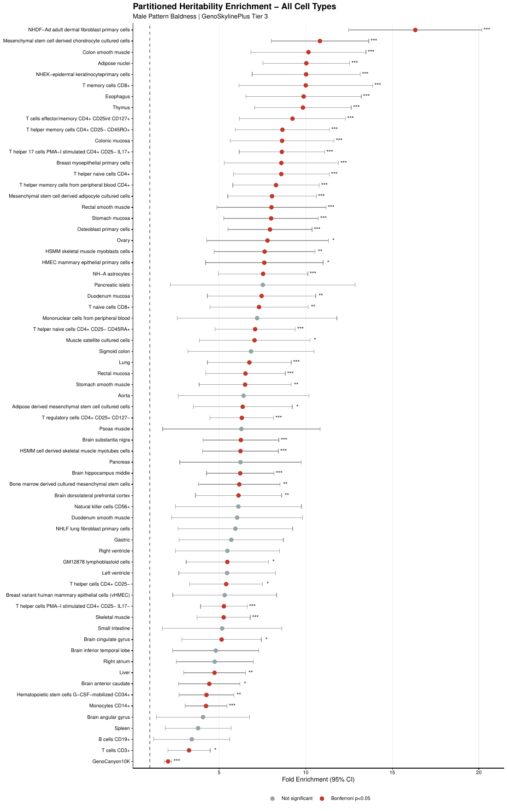

# Cell-Type Heritability of Male Pattern Baldness

Which cell types carry the genetic signal for male pattern baldness? Using stratified LD Score Regression on a UK Biobank GWAS of **205,327 men**, I tested 67 cell and tissue types and found that **dermal fibroblasts** stand out.

This was my part of a four-person team project for **Statistics in Human Genetics (STAT 620), UW–Madison, Spring 2026**. The full team analysis, which also covers SNP-heritability, genetic correlation, TWAS, and Mendelian randomization, is at **[spotnuru12/BMI-620-MPB](https://github.com/spotnuru12/BMI-620-MPB)**.

## Key result

SNPs in regulatory regions active in **adult dermal fibroblasts** make up just **3.4%** of SNPs but explain **55.9%** of the trait's SNP-heritability, a **16.3× enrichment** (p = 1.3 × 10⁻¹²). This points to hair-follicle biology, rather than systemic factors, as a main driver of baldness.

## Method

- **Partitioned heritability:** stratified LD Score Regression (S-LDSC; Finucane et al. 2015).
- **Annotations:** GenoSkylinePlus Tier 3 (67 cell and tissue types; Lu et al. 2016), modeled jointly with the Baseline v1.1 functional annotations.
- **Significance:** Bonferroni correction across all annotations tested (0.05 / 120 ≈ 4.2 × 10⁻⁴).
- **Self-taught tooling:** the course covered the statistical theory, so I learned to run S-LDSC and apply the GenoSkylinePlus annotations on my own.

## Files

- `scripts/03_partitioned_heritability_baldness.sh` — runs S-LDSC with the GenoSkylinePlus and Baseline annotations.
- `scripts/Baldness_EnrichmentPlot.R` — filters results, applies the Bonferroni threshold, and draws the figures (R, ggplot2).
- `results/` — LDSC enrichment output and log.
- `figures/` — cell-type and baseline enrichment plots.

Individual-level genotype data isn't used or shared. The input is publicly released GWAS summary statistics, and the LD reference files come from the LDSC project.
